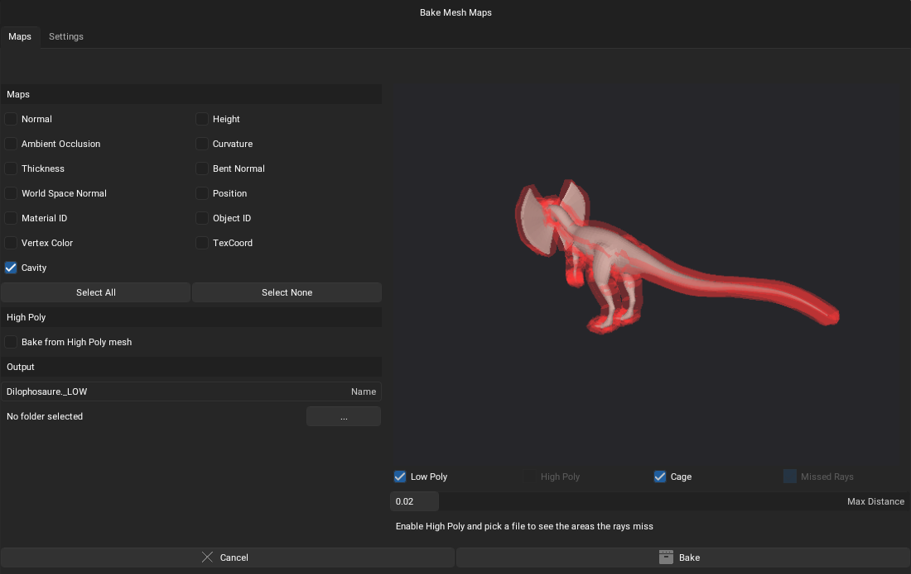
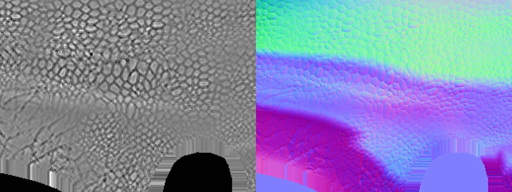
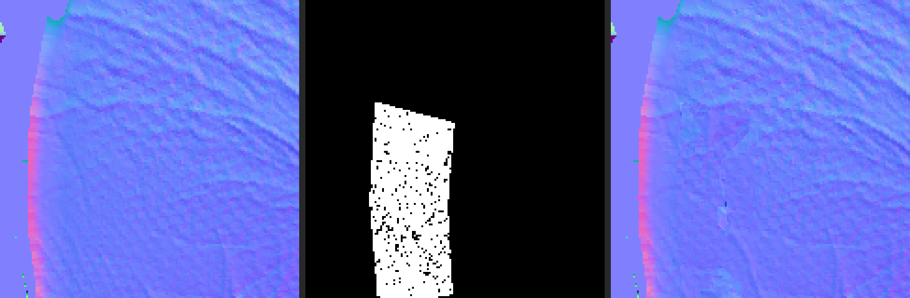
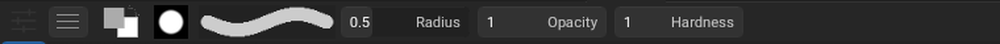
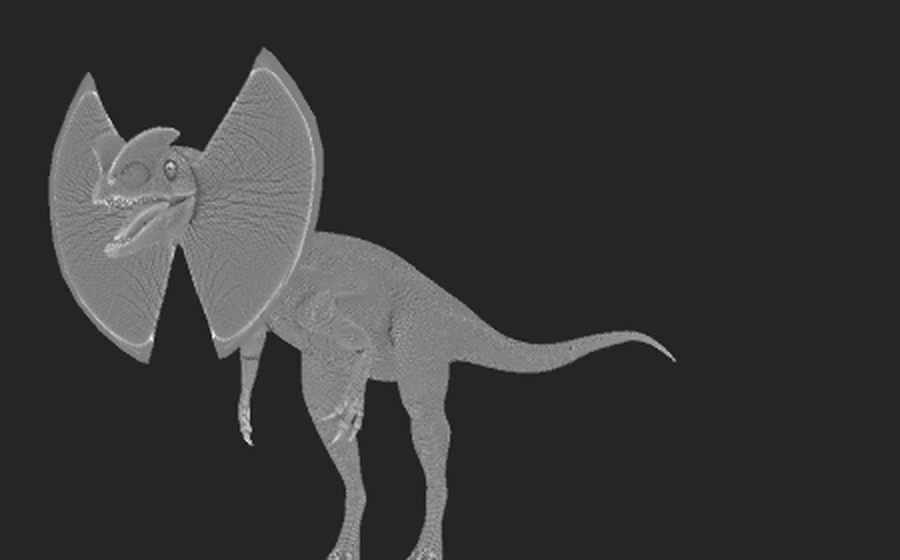

# Bake system, Inpaint tool and brush bar

This branch (`feature/bake-dialog`) adds a dedicated mesh map baker to ArmorPaint, a tool to repair bake artifacts, and a reworked brush toolbar. It is an unofficial fork made by an ArmorPaint user; it has not been reviewed by the ArmorPaint developer.
The code was written with Claude Code (Anthropic’s AI coding assistant), so it surely does not follow your conventions everywher

## Bake Mesh Maps

Open it with the **Bake** button in the top bar, or *File > Bake Mesh Maps...*.

- **13 maps**: Normal, Height, Ambient Occlusion, Curvature, Thickness, Bent Normal, World Space Normal, Position, Material ID, Object ID, Vertex Color, TexCoord and **Cavity**.
- **Bake from High Poly mesh** (.obj, .fbx, .gltf, .glb): the high poly does not need UVs. Rays are cast from a cage around the low poly; **Max Distance** sets the cage size and **Average Normals** keeps it closed over hard edges.
- **Live 3D preview**: low poly, high poly, transparent cage, and red areas where rays miss the high poly (with the percentage).
- **Device: GPU or CPU** (*Settings* tab). On the CPU every map can be baked, even without raytracing support, using all cores while the interface stays responsive. Without raytracing support the CPU is selected automatically.
- **Output**: `<name>_<map>.png` in the chosen folder, added to the project textures (reloaded when it already exists).
- **Baked material**: after a bake, a material named `<name> Baked` is created or updated with the Normal, AO and Height maps linked to the material output.
- The baked AO and Normal of the mesh are shown in the viewport; when a visible fill layer already uses them they are not applied twice.
- The high poly is never added to the scene and is released when the dialog closes (a 20 million triangle FBX takes about 3 GB while loaded, freed on close).

### Cavity

Signed curvature of the high poly surface: grooves are dark, ridges bright, flat areas mid gray. Made for scales, skin and pores, to be used as a mask. *Settings > Cavity* has **Detail Size** (texels, small for scales) and **Contrast**.

## Inpaint tool

Last icon of the toolbar, shortcut **I**. Paint over a bake artifact on the 3D model; when the mouse is released the baked maps of the mesh are rebuilt under the stroke and the png files are rewritten.

- **Copy**: rebuilds the texture from nearby patches of the same UV island (keeps the grain).
- **Smooth**: blends the surrounding values.
- **Maps**: all baked maps of the mesh, or a single one.
- **Ctrl+Z** or the **Undo** button restores the last repair. **F** changes the radius like the brush.

## Brush bar

With the header pinned, painting tools show: advanced options (UV scale, angle, blending, texcoord, X-ray), **primary and secondary colors** (click to edit, arrow or **Shift+X** to swap; the primary color is the Color node plugged into Base Color of the active material), **brush mask** (pick a project texture), a **live stroke preview**, radius, opacity, hardness, and **X Y Z symmetry** toggles on the right.

## Viewport modes

*Mode* menu:

| Mode | Shortcut | Shows |
|---|---|---|
| Normal (World) | Ctrl+M, W | Final normal after the normal map, in world space: continuous across UV seams when the bake is right |
| Cavity | Ctrl+M, C | The baked cavity map of the mesh |

| Normal (World) | Cavity |
|---|---|
|
 |  |

## Other changes

- The viewport tangent frame is built from the surface position instead of the view vector, which removed seams and view dependent dark patches on normal maps.
- The high poly projection keeps the surface closest to the low poly, like Marmoset Toolbag and xNormal.
- Missing normals in imported meshes are replaced by face normals.
- New viewport and bake code: `paint/sources/ui/box_bake.c`, `paint/sources/util/util_bake_rays.c`, `paint/sources/util/util_inpaint.c`, `paint/sources/ui/ui_brush_bar.c`.

## Known limits

- Normal maps use ArmorPaint's own tangent frame. Exported normal maps are correct in ArmorPaint but are **not yet MikkTSpace**, so they may look slightly different in other software. MikkTSpace tangents are prepared (`base/sources/libs/mikktspace.c`, `mesh_data_add_tangents` in `engine.c`) but disabled: the viewport shading with them is still wrong.
- Height is 8 bit, no anti-aliasing or separate front/rear distances yet.
- A mesh with corrupted custom normals shows dark patches in every software; reset its normals before baking.

## Build

Same as ArmorPaint (Windows: `..\base\make` in `paint`, then build `build\ArmorPaint.vcxproj` in Release x64 with the ClangCL toolset). Run the executable from `build\out`, next to its `data` folder.
